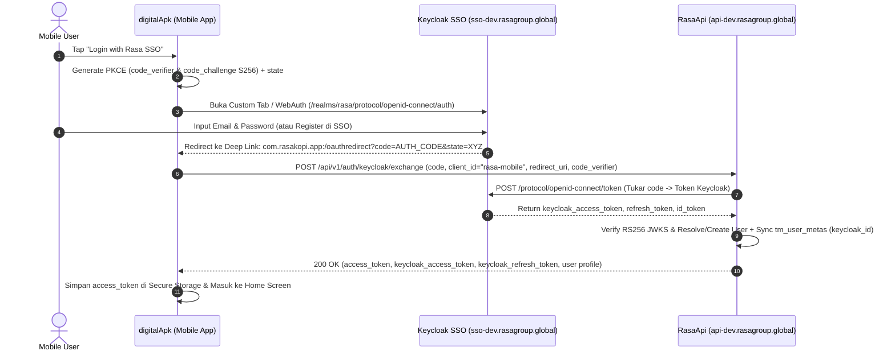

# 📱 Mobile Integration Guide: Rasa SSO (`digitalAuth`) for `digitalApk`

> **Target Application**: Rasa Kopi Mobile App (`https://github.com/rasagroup-global/digitalApk`)  
> **Environment**: Development (`sso-dev.rasagroup.global` & `api-dev.rasagroup.global`)  
> **Auth Protocol**: OAuth 2.0 / OpenID Connect (OIDC) Authorization Code Flow with **PKCE**  
> **Keycloak Realm**: `rasa`  
> **Mobile Client ID**: `rasa-mobile` (Public Client — No Client Secret required)

---

## 1. Gambaran Umum Arsitektur SSO Mobile

Mulai versi SSO terpusat (`digitalAuth`), aplikasi mobile **`digitalApk`** dapat melakukan autentikasi menggunakan **Rasa SSO (Keycloak)** dengan jaminan **100% Single Source of Truth** ke `RasaApi` (`digitalApi`).

Terdapat **3 Skema Integrasi** yang didukung penuh oleh `sso-dev` dan `api-dev` (termasuk **Skema Muhajir / Nafi** yang sudah dipakai oleh tim mobile):

1. **Skema 1 (Standar Muhajir / Nafi — `POST /api/v1/auth/login` & `GET /api/v1/auth/callback`)**:
   - **Native Login (`POST /api/v1/auth/login`)**: Mobile App mengirim `email` & `password` (opsional `keycloak: 1`, `remember: 1`). Backend `RasaApi` otomatis mengecek user ke Keycloak (`getUserInfo`), memvalidasi password ke Keycloak (`validateUserCredentials`), melakukan auto-mirror user dari Keycloak ke DB lokal jika belum ada, menyimpan `keycloak_id` di `tm_user_metas`, dan mengembalikan JWT token `RasaApi` beserta kode error terstruktur **`LoginError`** (`errors.code: ["ACCOUNT_NOT_FOUND" | "INVALID_CREDENTIALS" | "ACCOUNT_INACTIVE" | "EMAIL_NOT_VERIFIED" | "ACCOUNT_DISABLED" | "ACCOUNT_SETUP_REQUIRED"]`).
   - **OIDC Callback (`GET /api/v1/auth/callback?code=...&is_app=1`)**: Setelah login OIDC via browser/Google/Keycloak, mengirim `code` ke `/api/v1/auth/callback`. Jika `is_app=1`, otomatis me-redirect ke deep link `com.rasakopi.app:/oauthredirect?at=<JWT_TOKEN>`, atau jika tanpa `is_app=1` mengembalikan JSON `respondWithToken`.

2. **Skema 2 (OIDC Browser / Custom Tabs + PKCE Exchange via `POST /api/v1/auth/keycloak/exchange`)**:
   - Mobile App membuka halaman login SSO (`sso-dev.rasagroup.global`) menggunakan **Chrome Custom Tabs / ASWebAuthenticationSession**.
   - Setelah user login di SSO, Keycloak me-redirect kembali ke deep link aplikasi:
     `com.rasakopi.app:/oauthredirect?code=...&state=...`
   - Mobile App mengirim `code` + `code_verifier` (atau `access_token`) ke endpoint **`POST https://api-dev.rasagroup.global/api/v1/auth/keycloak/exchange`**.

3. **Skema 3 (Dual-Token Verification)**:
   - Semua endpoint `Authorization: Bearer <token>` di `RasaApi` menerima **token JWT dari `RasaApi` (HS256)** *maupun* **`access_token` langsung dari Keycloak (RS256)**.

---

## 2. Konfigurasi Endpoint `sso-dev` (Development)

| Parameter | Nilai (`sso-dev`) |
| :--- | :--- |
| **SSO Base URL** | `https://sso-dev.rasagroup.global` |
| **Realm** | `rasa` |
| **Client ID** | `rasa-mobile` |
| **Client Type** | `public` *(Tidak memakai `client_secret`, gunakan PKCE `S256`)* |
| **Deep Link Redirect URI** | `com.rasakopi.app:/oauthredirect` |
| **Scopes** | `openid email profile offline_access` |
| **OIDC Discovery URL** | `https://sso-dev.rasagroup.global/realms/rasa/.well-known/openid-configuration` |
| **Authorization Endpoint** | `https://sso-dev.rasagroup.global/realms/rasa/protocol/openid-connect/auth` |
| **Token Endpoint** | `https://sso-dev.rasagroup.global/realms/rasa/protocol/openid-connect/token` |
| **UserInfo Endpoint** | `https://sso-dev.rasagroup.global/realms/rasa/protocol/openid-connect/userinfo` |
| **Logout (End Session) Endpoint** | `https://sso-dev.rasagroup.global/realms/rasa/protocol/openid-connect/logout` |
| **JWKS Public Keys Endpoint** | `https://sso-dev.rasagroup.global/realms/rasa/protocol/openid-connect/certs` |
| **RasaApi Exchange Endpoint** | `POST https://api-dev.rasagroup.global/api/v1/auth/keycloak/exchange` |

---

## 3. Diagram Alur Login SSO Mobile (`digitalApk`)



---

## 4. Langkah Implementasi Detail di Mobile App

### Langkah 1: Konfigurasi Deep Link (`com.rasakopi.app:/oauthredirect`)

Pastikan scheme `com.rasakopi.app` sudah terdaftar di konfigurasi native Android & iOS (scheme ini juga sudah sama dengan yang dipakai `verifyOtp` di `RasaApi` baris `com.rasakopi.app:/oauthredirect?at=...`):

#### Android (`android/app/src/main/AndroidManifest.xml`)
Jika menggunakan library seperti `flutter_appauth` atau `react-native-app-auth`, tambahkan di `build.gradle`:
```groovy
android {
    defaultConfig {
        manifestPlaceholders += [
            'appAuthRedirectScheme': 'com.rasakopi.app'
        ]
    }
}
```
Atau jika menggunakan Deep Link Intent Filter manual di `AndroidManifest.xml`:
```xml
<intent-filter>
    <action android:name="android.intent.action.VIEW" />
    <category android:name="android.intent.category.DEFAULT" />
    <category android:name="android.intent.category.BROWSABLE" />
    <data android:scheme="com.rasakopi.app" android:path="/oauthredirect" />
</intent-filter>
```

#### iOS (`ios/Runner/Info.plist`)
```xml
<key>CFBundleURLTypes</key>
<array>
    <dict>
        <key>CFBundleTypeRole</key>
        <string>Editor</string>
        <key>CFBundleURLName</key>
        <string>com.rasakopi.app</string>
        <key>CFBundleURLSchemes</key>
        <array>
            <string>com.rasakopi.app</string>
        </array>
    </dict>
</array>
```

---

### Langkah 2: Buka URL Login SSO (PKCE S256)

Saat tombol **"Login with Rasa SSO"** ditekan:

1. Generate **`code_verifier`** (random string 43–128 karakter `[A-Za-z0-9-._~]`).
2. Hitung **`code_challenge`** = `BASE64URL_ENCODE(SHA256(code_verifier))` (tanpa padding `=`).
3. Generate **`state`** random string.
4. Arahkan browser / Custom Tab ke URL berikut:

```http
https://sso-dev.rasagroup.global/realms/rasa/protocol/openid-connect/auth
  ?client_id=rasa-mobile
  &redirect_uri=com.rasakopi.app%3A%2Foauthredirect
  &response_type=code
  &scope=openid%20email%20profile
  &state=<RANDOM_STATE>
  &code_challenge=<BASE64URL_SHA256_CHALLENGE>
  &code_challenge_method=S256
```

#### Direct "Continue with Google" via Keycloak (`kc_idp_hint=google`)
Jika di halaman login aplikasi mobile (`digitalApk`) terdapat tombol khusus **"Sign in with Google"** dan Anda ingin user langsung diarahkan ke layar pemilihan akun Google (melewati tampilan form email/password Keycloak), cukup tambahkan parameter **`&kc_idp_hint=google`** pada URL Authorization di atas:

```text
https://sso-dev.rasagroup.global/realms/rasa/protocol/openid-connect/auth?client_id=rasa-mobile&redirect_uri=com.rasakopi.app%3A%2Foauthredirect&response_type=code&scope=openid%20email%20profile&kc_idp_hint=google&state=<RANDOM_STATE>&code_challenge=<BASE64URL_SHA256_CHALLENGE>&code_challenge_method=S256
```
*(Jika menggunakan `flutter_appauth` atau `react-native-app-auth`, cukup tambahkan `additionalParameters: {'kc_idp_hint': 'google'}`)*.
Setelah user memilih akun Google, Keycloak akan tetap me-redirect kembali ke deep link `com.rasakopi.app:/oauthredirect?code=...` dengan alur pertukaran token yang 100% sama.

---

### Langkah 3: Tangkap Callback & Tukar Token ke `RasaApi`

Setelah user selesai login di halaman `sso-dev.rasagroup.global`, browser akan me-redirect ke aplikasi dengan URL:
```text
com.rasakopi.app:/oauthredirect?state=<RANDOM_STATE>&session_state=...&iss=https%3A%2F%2Fsso-dev.rasagroup.global%2Frealms%2Frasa&code=<AUTHORIZATION_CODE>
```

Mobile App memiliki **2 cara** untuk menukar `code` tersebut:

#### Cara 3A: Biarkan `RasaApi` yang Menukar `code` (Paling Mudah — 1x Request)
Kirim `code` dan `code_verifier` ke `RasaApi`:

- **Endpoint**: `POST https://api-dev.rasagroup.global/api/v1/auth/keycloak/exchange`
- **Headers**:
  ```http
  Accept: application/json
  Content-Type: application/json
  ```
- **Request Body**:
  ```json
  {
    "code": "<AUTHORIZATION_CODE_DARI_CALLBACK>",
    "client_id": "rasa-mobile",
    "redirect_uri": "com.rasakopi.app:/oauthredirect",
    "code_verifier": "<CODE_VERIFIER_YANG_DISIMPAN_DI_STEP_2>"
  }
  ```

#### Cara 3B: Jika SDK OIDC Mobile (`flutter_appauth` / `AppAuth`) Sudah Menukar `code` Sendiri ke Keycloak
Jika library OAuth di mobile sudah otomatis menukar `code` ke endpoint `/token` Keycloak dan Anda sudah memegang `access_token` dari Keycloak, cukup kirim `access_token` tersebut ke endpoint yang sama:

- **Endpoint**: `POST https://api-dev.rasagroup.global/api/v1/auth/keycloak/exchange`
- **Request Body**:
  ```json
  {
    "access_token": "<KEYCLOAK_ACCESS_TOKEN>",
    "refresh_token": "<KEYCLOAK_REFRESH_TOKEN>",
    "id_token": "<KEYCLOAK_ID_TOKEN>"
  }
  ```

---

### Langkah 4: Format Response dari `POST /api/v1/auth/keycloak/exchange`

Baik menggunakan **Cara 3A** maupun **Cara 3B**, `RasaApi` akan mengembalikan JSON standar yang sama persis struktur user-nya dengan login biasa:

```json
{
  "status": "success",
  "message": "SSO authentication successful",
  "data": {
    "access_token": "eyJ0eXAiOiJKV1QiLCJhbGciOiJIUzI1NiJ9...",
    "keycloak_access_token": "eyJhbGciOiJSUzI1NiIsInR5cCIgOiAiSldUI...",
    "keycloak_refresh_token": "eyJhbGciOiJIUzUxMiIsInR5cCIgOiAi...",
    "keycloak_id_token": "eyJhbGciOiJSUzI1NiIsInR5cCIgOiAiSldUI...",
    "keycloak_id": "f47ac10b-58cc-4372-a567-0e02b2c3d479",
    "token_type": "bearer",
    "expires_in": 2592000,
    "user": {
      "id": 125,
      "uuid": "8d13b4e0-9f1a-4b2c-8e3d-123456789abc",
      "name": "Budi Santoso",
      "email": "budi@rasakopi.coffee",
      "phone": "08123456789",
      "user_code": "CTM/0000000125",
      "wallet_code": "WU/26/11/22/001",
      "saldo_wallet": 150000,
      "keycloak_id": "f47ac10b-58cc-4372-a567-0e02b2c3d479",
      "status": 1,
      "status_label": "Active",
      "roles": [
        {
          "id": 2,
          "name": "user"
        }
      ],
      "metas": [
        {
          "meta_key": "keycloak_id",
          "meta_value": "f47ac10b-58cc-4372-a567-0e02b2c3d479"
        },
        {
          "meta_key": "user_level",
          "meta_value": "1"
        }
      ]
    }
  }
}
```

> **Catatan Penting untuk Mobile Developer:**
> - Anda bisa menyimpan `data.access_token` (atau `data.keycloak_access_token`) ke dalam Secure Storage aplikasi dan mengirimkannya pada header `Authorization: Bearer <token>` untuk semua request API selanjutnya (`/api/v1/me`, `/api/v1/orders`, `/api/v1/carts`, dll.).
> - `RasaApi` sudah mendukung **Dual-Token Verification**: baik `data.access_token` (HS256) maupun `data.keycloak_access_token` (RS256) diterima oleh seluruh endpoint `auth:api`!

---

## 5. Contoh Kode Implementasi (Flutter / Dart & React Native)

### A. Contoh Flutter (`flutter_appauth` + `dio` / `http`)

```dart
import 'package:flutter_appauth/flutter_appauth.dart';
import 'package:http/http.dart' as http;
import 'dart:convert';

class RasaSsoService {
  static const String ssoIssuer = 'https://sso-dev.rasagroup.global/realms/rasa';
  static const String clientId = 'rasa-mobile';
  static const String redirectUri = 'com.rasakopi.app:/oauthredirect';
  static const String apiBaseUrl = 'https://api-dev.rasagroup.global/api/v1';

  final FlutterAppAuth _appAuth = const FlutterAppAuth();

  Future<Map<String, dynamic>?> loginWithRasaSso() async {
    try {
      // 1. Trigger OIDC Login + PKCE via Chrome Custom Tabs / ASWebAuthenticationSession
      final AuthorizationTokenResponse? result =
          await _appAuth.authorizeAndExchangeCode(
        AuthorizationTokenRequest(
          clientId,
          redirectUri,
          issuer: ssoIssuer,
          scopes: ['openid', 'email', 'profile', 'offline_access'],
          promptValues: ['login'],
        ),
      );

      if (result == null || result.accessToken == null) {
        return null;
      }

      // 2. Sync & Exchange dengan RasaApi untuk mendapatkan Full Profile, Loyalty & Wallet
      final response = await http.post(
        Uri.parse('$apiBaseUrl/auth/keycloak/exchange'),
        headers: {
          'Accept': 'application/json',
          'Content-Type': 'application/json',
        },
        body: jsonEncode({
          'access_token': result.accessToken,
          'refresh_token': result.refreshToken,
          'id_token': result.idToken,
        }),
      );

      if (response.statusCode == 200) {
        final Map<String, dynamic> body = jsonDecode(response.body);
        return body['data']; // Berisi access_token, keycloak_id, dan user object
      } else {
        throw Exception('Failed to sync SSO token with RasaApi: ${response.body}');
      }
    } catch (e) {
      rethrow;
    }
  }
}
```

### B. Contoh React Native (`react-native-app-auth`)

```javascript
import { authorize } from 'react-native-app-auth';

const ssoConfig = {
  issuer: 'https://sso-dev.rasagroup.global/realms/rasa',
  clientId: 'rasa-mobile',
  redirectUrl: 'com.rasakopi.app:/oauthredirect',
  scopes: ['openid', 'email', 'profile', 'offline_access'],
  usePKCE: true,
};

export async function loginWithRasaSso() {
  // 1. Buka layar login Keycloak SSO
  const authState = await authorize(ssoConfig);

  // 2. Tukar & sinkronkan token ke RasaApi
  const response = await fetch('https://api-dev.rasagroup.global/api/v1/auth/keycloak/exchange', {
    method: 'POST',
    headers: {
      Accept: 'application/json',
      'Content-Type': 'application/json',
    },
    body: JSON.stringify({
      access_token: authState.accessToken,
      refresh_token: authState.refreshToken,
      id_token: authState.idToken,
    }),
  });

  const json = await response.json();
  if (!response.ok) {
    throw new Error(json.message || 'SSO Exchange failed');
  }

  // Simpan json.data.access_token & json.data.user
  return json.data;
}
```

---

## 6. Alur Refresh Token & Single Logout (SLO)

### 6.1 Refresh Token
- Jika mobile app menggunakan `data.access_token` (`RasaApi` JWT), refresh token tetap dapat memanggil:
  `POST https://api-dev.rasagroup.global/api/v1/auth/refresh` (dengan header `Authorization: Bearer <access_token>`).
- Jika mobile app ingin me-refresh `keycloak_access_token` menggunakan `keycloak_refresh_token`:
  ```http
  POST https://sso-dev.rasagroup.global/realms/rasa/protocol/openid-connect/token
  Content-Type: application/x-www-form-urlencoded

  grant_type=refresh_token
  &client_id=rasa-mobile
  &refresh_token=<KEYCLOAK_REFRESH_TOKEN>
  ```

### 6.2 Single Logout (SLO)
Saat user menekan tombol **Logout** di aplikasi mobile:
1. Panggil endpoint logout `RasaApi`:
   `POST https://api-dev.rasagroup.global/api/v1/auth/logout` (Header: `Authorization: Bearer <access_token>`).
2. Hapus sesi SSO di Keycloak (opsional via backchannel POST agar tidak perlu membuka browser saat logout):
   ```http
   POST https://sso-dev.rasagroup.global/realms/rasa/protocol/openid-connect/logout
   Content-Type: application/x-www-form-urlencoded

   client_id=rasa-mobile
   &refresh_token=<KEYCLOAK_REFRESH_TOKEN>
   ```
3. Bersihkan token dari local Secure Storage di device.

---

## 7. Checklist Testing untuk Tim Mobile (`digitalApk`)

- [ ] **Test 1 (OIDC Discovery)**: Pastikan device/emulator dapat mengakses `https://sso-dev.rasagroup.global/realms/rasa/.well-known/openid-configuration`.
- [ ] **Test 2 (Deep Link Redirect)**: Pastikan klik tombol **Login with Rasa SSO** membuka halaman login bertema Rasa Kopi (`sso-dev.rasagroup.global`), dan setelah login berhasil me-redirect kembali ke aplikasi (`com.rasakopi.app:/oauthredirect`).
- [ ] **Test 3 (Token Exchange & User Profile)**: Pastikan panggilan `POST /api/v1/auth/keycloak/exchange` mengembalikan `200 OK` beserta `data.access_token`, `data.user.keycloak_id`, `data.user.saldo_wallet`, dan `data.user.metas`.
- [ ] **Test 4 (Authenticated Endpoint)**: Gunakan `access_token` yang didapat untuk memanggil `GET https://api-dev.rasagroup.global/api/v1/me` dan pastikan profil user termuat dengan benar.
- [ ] **Test 5 (Single Source of Truth Compatibility)**: Coba login dengan akun yang baru dibuat lewat SSO di WooCommerce (`shop-dev.rasakopi.coffee`) pada aplikasi mobile — pastikan user langsung masuk dengan saldo wallet dan poin loyalty yang sama.
