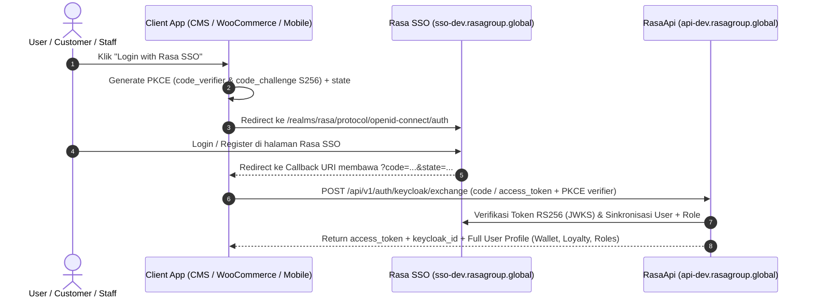

# 🔐 digitalAuth — Rasa Group Centralized Keycloak SSO Service

Centralized Single Sign-On (SSO) & OpenID Connect (OIDC) Identity Provider powered by **Keycloak 26** for the entire **Rasa Group** ecosystem (`digitalApi`, `digitalCms`, `digitalCommerce`, and `digitalApk`).

---

## 1. Connected Applications & OIDC Clients (Realm: `rasa`)

| Application | Repository | Client ID | Access Type | Redirect URI / Callback |
| :--- | :--- | :--- | :--- | :--- |
| **`RasaApi`** (`digitalApi`) | `rasagroup-global/digitalApi` | `rasa-api` | Confidential (`client_secret` + Service Account) | `https://api-dev.rasagroup.global/api/v1/auth/keycloak/callback` |
| **`digitalCms`** | `rasagroup-global/digitalCms` | `rasa-cms` | Confidential (`client_secret` + PKCE) | `https://cms-dev.rasagroup.global/auth/keycloak/callback` |
| **`digitalCommerce`** (WooCommerce) | `rasagroup-global/digitalCommerce` | `rasa-commerce` | Confidential (`client_secret` + PKCE) | `https://shop-dev.rasakopi.coffee/?rasa_sso=callback` |
| **`digitalApk`** (Mobile App) | `rasagroup-global/digitalApk` | `rasa-mobile` | Public (PKCE `S256` Only — No Secret) | `com.rasakopi.app:/oauthredirect` |

---

## 2. Environments & OIDC Endpoints (`rasa` Realm)

| Environment | Base URL | OIDC Discovery Endpoint |
| :--- | :--- | :--- |
| **Local Dev** | `http://localhost:8081` | `http://localhost:8081/realms/rasa/.well-known/openid-configuration` |
| **Development (`sso-dev`)** | `https://sso-dev.rasagroup.global` | `https://sso-dev.rasagroup.global/realms/rasa/.well-known/openid-configuration` |
| **Production (`sso`)** | `https://sso.rasagroup.global` | `https://sso.rasagroup.global/realms/rasa/.well-known/openid-configuration` |

### Core OIDC Endpoints (`sso-dev`)
- **Issuer**: `https://sso-dev.rasagroup.global/realms/rasa`
- **Authorization Endpoint**: `https://sso-dev.rasagroup.global/realms/rasa/protocol/openid-connect/auth`
- **Token Endpoint**: `https://sso-dev.rasagroup.global/realms/rasa/protocol/openid-connect/token`
- **UserInfo Endpoint**: `https://sso-dev.rasagroup.global/realms/rasa/protocol/openid-connect/userinfo`
- **Logout (End Session) Endpoint**: `https://sso-dev.rasagroup.global/realms/rasa/protocol/openid-connect/logout`
- **JWKS Public Keys Endpoint**: `https://sso-dev.rasagroup.global/realms/rasa/protocol/openid-connect/certs`
- **Central API Exchange Endpoint**: `POST https://api-dev.rasagroup.global/api/v1/auth/keycloak/exchange`

---

## 3. SSO Login Integration Guide (Step-by-Step)

Seluruh aplikasi di ekosistem Rasa menggunakan alur **OAuth 2.0 / OIDC Authorization Code Flow with PKCE (`S256`)** yang terintegrasi dengan **`RasaApi`** sebagai *Single Source of Truth*.

### Alur Umum Login SSO


---

### A. Panduan Login SSO untuk Mobile App (`digitalApk`)

> Dokumentasi lengkap tersedia di [`DOCS/MOBILE_SSO_INTEGRATION_GUIDE.md`](DOCS/MOBILE_SSO_INTEGRATION_GUIDE.md).

1. **Parameter Client**:
   - `issuer`: `https://sso-dev.rasagroup.global/realms/rasa`
   - `client_id`: `rasa-mobile` (Public Client, tanpa `client_secret`)
   - `redirect_uri`: `com.rasakopi.app:/oauthredirect`
   - `scopes`: `openid email profile offline_access`
   - `code_challenge_method`: `S256`

2. **Buka Halaman Login SSO (Custom Tabs / WebAuth)**:
   Arahkan user ke Authorization Endpoint dengan PKCE:
   ```http
   https://sso-dev.rasagroup.global/realms/rasa/protocol/openid-connect/auth
     ?client_id=rasa-mobile
     &redirect_uri=com.rasakopi.app%3A%2Foauthredirect
     &response_type=code
     &scope=openid%20email%20profile%20offline_access
     &state=<RANDOM_STATE>
     &code_challenge=<BASE64URL_SHA256_CHALLENGE>
     &code_challenge_method=S256
   ```

3. **Tukar Code / Token ke `RasaApi` (`/api/v1/auth/keycloak/exchange`)**:
   Setelah aplikasi menerima deep link callback `com.rasakopi.app:/oauthredirect?code=<AUTH_CODE>&state=<STATE>`, kirim request ke `RasaApi`:
   ```http
   POST https://api-dev.rasagroup.global/api/v1/auth/keycloak/exchange
   Accept: application/json
   Content-Type: application/json
   ```
   **Request Body (Opsi 1 — Kirim `code` + `code_verifier`):**
   ```json
   {
     "code": "<AUTH_CODE_DARI_CALLBACK>",
     "client_id": "rasa-mobile",
     "redirect_uri": "com.rasakopi.app:/oauthredirect",
     "code_verifier": "<PKCE_CODE_VERIFIER>"
   }
   ```
   **Request Body (Opsi 2 — Jika SDK seperti `flutter_appauth` / `AppAuth` sudah menukar `code` menjadi token):**
   ```json
   {
     "access_token": "<KEYCLOAK_ACCESS_TOKEN>",
     "refresh_token": "<KEYCLOAK_REFRESH_TOKEN>",
     "id_token": "<KEYCLOAK_ID_TOKEN>"
   }
   ```

4. **Response dari `RasaApi`**:
   ```json
   {
     "status": "success",
     "message": "SSO authentication successful",
     "data": {
       "access_token": "<RASA_API_BEARER_TOKEN>",
       "keycloak_access_token": "<KEYCLOAK_RS256_ACCESS_TOKEN>",
       "keycloak_refresh_token": "<KEYCLOAK_REFRESH_TOKEN>",
       "keycloak_id_token": "<KEYCLOAK_ID_TOKEN>",
       "keycloak_id": "f47ac10b-58cc-4372-a567-0e02b2c3d479",
       "token_type": "bearer",
       "expires_in": 2592000,
       "user": {
         "id": 125,
         "uuid": "8d13b4e0-9f1a-4b2c-8e3d-123456789abc",
         "name": "Budi Santoso",
         "email": "budi@rasakopi.coffee",
         "wallet_code": "WU/26/11/22/001",
         "saldo_wallet": 150000,
         "keycloak_id": "f47ac10b-58cc-4372-a567-0e02b2c3d479",
         "roles": [{ "id": 2, "name": "user" }]
       }
     }
   }
   ```
   Simpan `data.access_token` dan gunakan pada header `Authorization: Bearer <access_token>` untuk seluruh panggilan endpoint `RasaApi`.

---

### B. Panduan Login SSO untuk Web Portal (`digitalCms`)

1. User membuka halaman Login CMS (`/login`) dan menekan tombol **"Login with Rasa SSO"** (`GET /auth/keycloak/redirect`).
2. `KeycloakAuthController` membuat `state` dan `code_verifier` (PKCE) di session, lalu mengarahkan browser ke `sso-dev.rasagroup.global` (`client_id=rasa-cms`).
3. Setelah autentikasi berhasil, Keycloak mengarahkan user kembali ke `GET /auth/keycloak/callback`.
4. CMS menukar kode melalui `POST /api/v1/auth/keycloak/exchange` di `RasaApi`, mengisi session user (`api_token`, `roles`, `permissions`, `companies`, `user_warehouses`), dan mengarahkan otomatis berdasarkan role:
   - Role `cashier` $\rightarrow$ `/cashier`
   - Role `kitchen` / `barista` $\rightarrow$ `/kitchen`
   - Role `super-admin` / `admin` $\rightarrow$ `/dashboard`
5. Saat user klik **Logout** (`POST /logout`), sesi CMS dihapus dan browser diarahkan ke endpoint Single Logout (SLO) Keycloak.

---

### C. Panduan Login SSO untuk WooCommerce (`digitalCommerce`)

1. Pelanggan B2C maupun B2B membuka halaman `/my-account/` dan menekan tombol **"Mit Rasa SSO anmelden" / "Login with Rasa SSO"** (`/?rasa_sso=login`).
2. Modul `theme/rasa-kopi/inc/rasa-keycloak-sso.php` mengarahkan browser ke `sso-dev.rasagroup.global` (`client_id=rasa-commerce`) dengan PKCE.
3. Saat callback (`/?rasa_sso=callback`), WooCommerce menyinkronkan profil melalui `RasaApi`:
   - Menyimpan `keycloak_id` (`keyloack_id`) dan `_rasa_user_uuid` di `wp_usermeta`.
   - Jika user memiliki role **`b2b_customer`** di SSO, role WordPress otomatis diset ke `b2b_customer` sehingga tampilan harga Net (`excl. MwSt.`) dan fitur reverse charge EU VAT langsung aktif.
   - Menampilkan kartu status **Rasa SSO & Loyalty Points** di dashboard *My Account*.

---

## 4. Single Source of Truth (SSOT) Synchronization

- **Identity Binding (`tm_user_metas`)**:
  `RasaApi` menyimpan Subject UUID Keycloak setiap user di tabel `tm_user_metas` dengan `meta_key = "keycloak_id"` (serta `"keyloack_id"`).
- **Dual-Token Verification**:
  Semua endpoint `auth:api` di `RasaApi` menerima **Keycloak RS256 Access Token** (diverifikasi secara cepat menggunakan cached JWKS) **maupun** **RasaApi HS256 JWT Token**.
- **Sinkronisasi Otomatis Dua Arah**:
  - Setiap registrasi, login form biasa, ganti password/email/nomor telepon via OTP, social login, maupun pembuatan/update user dari CMS atau WooCommerce secara otomatis disinkronkan ke Keycloak melalui service account `rasa-api`.
  - Setiap user baru yang mendaftar lewat halaman SSO Keycloak otomatis dibuatkan profil lengkap di `RasaApi` (beserta `wallet_code`, `user_code`, dan loyalty level awal) saat pertama kali bertukar token.
- **Bulk Sync Existing Users**:
  Untuk menyinkronkan seluruh user eksisting di database `RasaApi` ke Keycloak, jalankan dari container/folder `RasaApi`:
  ```bash
  php artisan keycloak:sync-users
  ```

---

## 5. Local Development Setup

1. Salin file `.env.example` ke `.env` dan sesuaikan nilai variabel environment lokal Anda:
   ```bash
   cp .env.example .env
   ```
2. Jalankan container Keycloak beserta PostgreSQL lokal:
   ```bash
   docker compose -f docker-compose.yml -f docker-compose.local.yml up -d
   ```
3. Realm **`rasa`**, custom login theme **`rasa-kopi`**, beserta seluruh konfigurasi client (`rasa-api`, `rasa-cms`, `rasa-commerce`, `rasa-mobile`) akan otomatis ter-import dari `realms/rasa-realm.json` pada `http://localhost:8081`.
